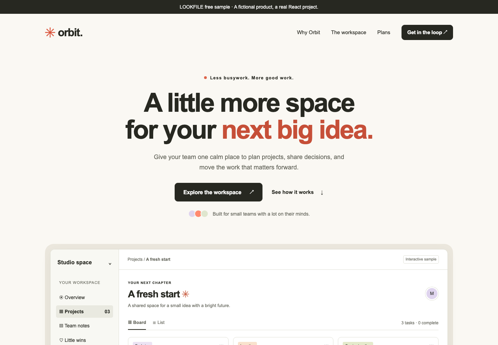

# Orbit Workspace — free React frontend by LOOKFILE

A runnable React + TypeScript project for a fictional productivity product, with the design context and editing instructions included. Published by LOOKFILE.

**[Open the live preview](https://preview.lookfileai.com/kits/orbit-workspace/1.1.1/) · [View the free kit on LOOKFILE](https://lookfileai.com/product/orbit-workspace) · [Download the source ZIP](./orbit-workspace-1.1.1.zip)**



## What you can try

Open the project, change the product name and primary action, then add one FAQ while keeping the existing spacing, typography and colors. The source includes responsive navigation, board/list switching, a task checkbox, a pricing toggle and an FAQ accordion. These are frontend demos; the sample does not include a backend, payments, authentication, or an AI subscription.

The ZIP contains the complete source, `design/` rules and tokens, `AGENTS.md`, `brand-input.json`, five task prompts, a brand-system page, and project checks. It is available without a LOOKFILE account or card.

## Run it

Download and extract `orbit-workspace-1.1.1.zip`. Use Node.js 22, then run in the extracted folder:

```sh
npm ci
npm run dev
npm run verify
```

The dev server is local-only. Read `START-HERE.md` before changing the source. Dependencies are pinned to the published sample; review dependency updates before deploying your own project. `npm run verify` checks types and builds the project. It does not replace a visual review or connect a backend.

## Try one focused AI edit

Open the whole extracted folder in your own coding assistant and start with:

> Read AGENTS.md, design/DESIGN.md and brand-input.json. Change the hero copy for my project and add one FAQ using the existing components, spacing and typography. Keep unrelated sections unchanged. List the changed files, then run npm run verify. Tell me what still needs manual review.

Use your own project details in `brand-input.json`. The playbook is Markdown; results depend on your tool and review. No model performance or time-saving claim is made here.

## Exact release and license

This repository distributes the original LOOKFILE **Orbit Workspace 1.1.1** source archive unchanged.

- SHA-256: `7b978095846ef75a1584d8c9eb94e718960e9afd244c1cf2b753d6f395ed6ce1`
- Archive size: 295,284 bytes; 61 files.
- MIT license: keep the included copyright and permission notice. See `LICENSE.md` and the archive's `ASSET-LICENSES.md` for notices.
- The names, tasks and screenshots are a fictional studio example, not customer testimonials.
- Packaged version included; future updates and response times are not promised.

[Explore LOOKFILE's kits and their actual release details](https://lookfileai.com/catalog).
